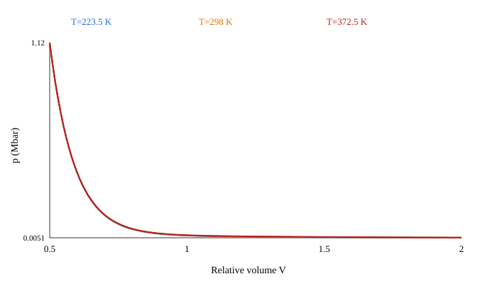
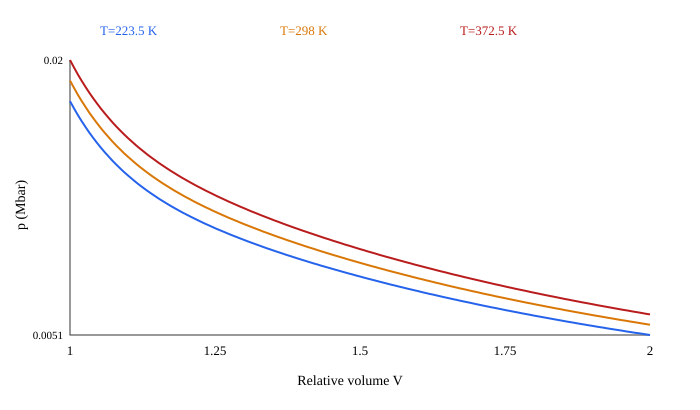

# jh2: Lee–Tarver audit

## Identification

- Calibration: Product EOS and ENQ are from a 1.667 g/cm3 8701 calibration; unreacted EOS and kinetics are reported at 1.717 g/cm3. Hong et al. report a different product JWL for 8701 at 1.72 g/cm3, but no CVP/CVR. Reactant B now follows Hong and Awan (+0.0328 Mbar). CVR is a pure-RDX room-temperature estimate, not a JH-2 calibration; CVP, T0 and reaction limits retain legacy values. This combination produces about 1.89 GPa initial pressure at 298 K and is not a validated initiation card.
- Initial density: 1.717 g/cm³ (reported reactant/kinetics density; product differs); temperature: 298 K.
- Source: Composite experimental card: [Zhu et al. (2022), Table 2](https://www.sciengine.com/parse/pdf/2096-2304/B0290F3EBF5E4846B7046AB9E2778AD4.pdf); [Hong et al. (2020), Tables 1-3](https://doi.org/10.1016/j.dt.2019.04.007); [Awan et al., Aerospace (2024), Tables 4-5](https://www.researchgate.net/publication/381763413_Application_of_Lee-Tarver_Model_for_Energetic_Materials_Safety_Assessment_Utilized_in_Aerospace_Applications); [Cawkwell et al. (2016), p. 4](https://www.osti.gov/servlets/purl/1498045) for pure RDX CVR; pre-audit kunit card for remaining fields. Raw values: mixed literature and pre-audit kunit card; stored units: cm–g–µs (Mbar, µs).
- Status: **source_conflict**. This is an experimental composite card, not a verified calibration.

## Density consistency

| EOS calibration ρ0 | Kinetic calibration ρ0 | *MAT RO | Library output |
|---:|---:|---:|---|
| product 1.667; reactant 1.717 | 1.717 | 1.717 | stored density is enforced when a MAT card exists |

Changing RO requires a separately identified calibration; the material loader rejects silent density edits to these source-backed cards.

## Parameter provenance and conflict

- Product A, B, XP1, XP2, ω and ENQ: [Zhu et al. (2022), Table 2](https://www.sciengine.com/parse/pdf/2096-2304/B0290F3EBF5E4846B7046AB9E2778AD4.pdf), 8701 at 1.667 g/cm³.
- [Hong et al. (2020), Tables 1–3](https://doi.org/10.1016/j.dt.2019.04.007) report an I&G model for 8701 in AUTODYN at 1.72 g/cm³. Table 1 has a different product JWL (A=8.524, B=0.1802 Mbar, R1=4.6, R2=1.3, ω=0.38); Tables 2–3 report the reactant EOS and rates. Hong does not provide CVP, CVR or the temperature reference needed to transfer that I&G set to LS-DYNA.
- [Awan et al., Aerospace (2024)](https://www.researchgate.net/publication/381763413_Application_of_Lee-Tarver_Model_for_Energetic_Materials_Safety_Assessment_Utilized_in_Aerospace_Applications), Table 2, gives **A=6.184, B=0.069 Mbar, R1=4.3, R2=0.87, ω=0.38 at 1.72 g/cm³** for the JH-2 *threat shaped charge* modeled with JWL/high-explosive burn. Its Tables 4–5 describe the JH-2 *target* reactant and I&G rates. Table 2 is not identified as the target I&G product branch and does not supply CVP; inserting it into this card would still leave an incomplete target calibration.
- Reactant R1, R2, R5, R6, ω and I, G1, G2, a, b, c, d, e, g, x, y, z: [Hong et al. (2020), Tables 2–3](https://doi.org/10.1016/j.dt.2019.04.007), [Awan et al., Aerospace (2024), Tables 4–5](https://www.researchgate.net/publication/381763413_Application_of_Lee-Tarver_Model_for_Energetic_Materials_Safety_Assessment_Utilized_in_Aerospace_Applications) and [Awan et al., CEJEM (2024), Tables 2–3](https://wydawnictwa.ipo.lukasiewicz.gov.pl/wp-content/uploads/2024/11/CEJEM-1327-v0-Huang.pdf), at 1.72 or 1.717 g/cm³ depending on publication.
- Awan labels EOS pressure in Mbar but does not label the units of G1/G2 in its rate table. Their Mbar pressure basis is inferred from the article's EOS and the pre-audit card; the 140→0.014 and 1000→0.001 conversions therefore inherit this uncertainty.
- Reactant R2=**+0.0328 Mbar** follows Hong and Awan. CVR is computed from the **pure α-RDX, 300 K, model Cᵥ=217.1 J/(mol K)** in [Cawkwell et al. (2016), p. 4](https://www.osti.gov/servlets/purl/1498045), [RDX molar mass 222.1163 g/mol, NIST](https://webbook.nist.gov/cgi/cbook.cgi?Name=RDX), and reference density 1.717 g/cm³: CVR=ρ₀ Cᵥ/M/10¹¹=1.6782231·10⁻⁵ Mbar/K. This is a pure-RDX proxy, **not** a measured or calibrated JH-2 CVR. R3 is computed as 0.8938×CVR.
- CVP=10⁻⁵ Mbar/K, TMP0=298 K and FMXIG/FMXGR/FMNGR=0.022/1/0 retain the [pre-audit kunit card](source_search.md) values; no JH-2 source was found for them. CVP describes reaction products and cannot be inferred from solid RDX heat capacity.
- With published positive R2 and pure-RDX CVR, the LS-DYNA temperature form gives **p₀≈+1.89 GPa at 298 K**. This is an inconsistent initial state for ambient material; neither Hong nor Awan publishes the missing temperature/energy reference for direct transfer. Do not use this card as a validated initiation threshold.

## Product EOS

p_p = A exp(−XP1 V_p) + B exp(−XP2 V_p) + G T_p/V_p, where G=ω_p CVP.

| Model | LS-DYNA | Raw (Mbar, Mbar/K) | mm–mg–µs (GPa, GPa/K) |
|---|---|---:|---:|
| A | A | 6.125 | 612.5 |
| B | B | 0.1395 | 13.95 |
| R1 | XP1 | 4.5 | 4.5 |
| R2 | XP2 | 1.4 | 1.4 |
| ω | G/CVP | 0.25 | 0.25 |
| Cv | CVP | 1e-05 | 0.001 |
| ωCv | G | 2.5e-06 | 0.00025 |

## Unreacted EOS

p_e = R1 exp(−R5 V_e) + R2 exp(−R6 V_e) + R3 T_e/V_e, where R3=ω_e CVR for a sourced ω_e.

| Model | LS-DYNA | Raw (Mbar, Mbar/K) | mm–mg–µs (GPa, GPa/K) |
|---|---|---:|---:|
| A | R1 | 310 | 31000 |
| B | R2 | 0.0328 | 3.28 |
| R1 | R5 | 11.3 | 11.3 |
| R2 | R6 | 1.13 | 1.13 |
| ω | R3/CVR | 0.8938 | 0.8938 |
| Cv | CVR | 1.6782231e-05 | 0.0016782231 |
| ωCv | R3 | 1.4999958e-05 | 0.0014999958 |

At V=1, T=T0: source p0=0.018901085 Mbar; **card p0=0.018901097 Mbar = 1.8901097 GPa**.
Expected initial pressure: not established for this untraced calibration.
Source G/CVP=0.25, R3/CVR=0.8938; card G/CVP=0.25, R3/CVR=0.8938148.
Warning: residual initial pressure exceeds 1 MPa; published initial-state conditions are needed before use.
Automated flags: large initial pressure residual. A ratio outside [0, 2] requires manual review; a residual over 1 MPa is flagged, without imposing p0=0 on every calibration.
The tables combine literature values and the legacy assumptions listed above; the displayed card is [here](jh-2.k).

## Ignition and Growth kinetics

The LS-DYNA equation is dF/dt = I(1−F)^b(1/V_e−1−a)^x + G1(1−F)^c F^d p^y + G2(1−F)^e F^g p^z, with each term restricted by its listed F limits. Pressure p is in the active unit system.

Field definitions follow the [LS-DYNA R13 EOS 7 manual](https://ftp.lstc.com/anonymous/outgoing/jday/manuals/LS-DYNA_Manual_Volume_II_R13.pdf).

| Model | LS-DYNA | Raw | mm–mg–µs |
|---|---|---:|---:|
| I | FREQ | 4000000 | 4000000 |
| a | CCRIT | 0.022 | 0.022 |
| b | FRER | 0.667 | 0.667 |
| x | EETAL | 7 | 7 |
| F_ig,max | FMXIG | 0.022 | 0.022 |
| G1 | GROW1 | 140 | 0.014 |
| c | ES1 | 0.667 | 0.667 |
| d | AR1 | 0.329 | 0.329 |
| y | EM | 2 | 2 |
| F_g1,max | FMXGR | 1 | 1 |
| G2 | GROW2 | 1000 | 0.001 |
| e | ES2 | 0.067 | 0.067 |
| g | AR2 | 0.333 | 0.333 |
| z | EN | 3 | 3 |
| F_g2,min | FMNGR | 0 | 0 |

FREQ has unit µs⁻¹. GROW1 and GROW2 are assumed to have units Mbar⁻ʸ µs⁻¹ and Mbar⁻ᶻ µs⁻¹. Conversion to GPa pressure units divides them by 100^y and 100^z. This keeps each Gp^n unchanged. The same µs time unit needs no rate multiplier.

## Dimensions and ENQ

The working base units are mm, mg, µs. Derived units: density mg/mm³ = 1000 kg/m³; speed mm/µs = 1000 m/s; acceleration mm/µs² = 10⁹ m/s²; force mg·mm/µs² = 10³ N; pressure mg/(mm·µs²) = 1 GPa; energy mg·mm²/µs² = 1 J; specific energy mm²/µs² = 10⁶ J/kg. Card CVP, CVR, G and R3 are heat capacity or thermal pressure coefficients **per reference volume**, in GPa/K; mass-specific heat instead has dimension J/(kg·K). ENQ maps to Zhu et al. E0 at 1.667 g/cm³, applied here to a different MAT density, so 0.09 Mbar becomes 9 GPa; it is not treated as mass-specific energy. This mapping is documented in an [LS-DYNA Users Conference paper](https://lsdyna.ansys.com/wp-content/uploads/attachments/blast-impact13-d.pdf). I has dimension T⁻¹; Gi has dimension P⁻ⁿT⁻¹.

## Applicability and EOS scan

Scan: 0.5≤V≤2.0, T=0.75T0, T0, 1.25T0. At T0, pressure ranges from 0.0056577371 to 1.1180124 Mbar. Negative p at T0: none on scanned grid. First nonpositive adiabatic bulk modulus: none on scanned grid; this also flags potential c²≤0 because c²=V K_S/ρ0. K_S=V(A_e R1e exp(−R1e V)+B_e R2e exp(−R2e V))+ω_e(1+ω_e)Cv,e T/V. Nonfinite values: False. The scan diagnoses extrapolation only; it does not establish a valid tensile range. Published tensile limits, pressure cutoffs, phase-mixing rules and AUTODYN-to-LS-DYNA equivalence are **not established** for this set.

- Published pressure and compression calibration ranges: not established from the cited table.
- Tensile calibration range, maximum unreacted V, pressure cutoff and temperature bounds: not established.
- AUTODYN and LS-DYNA mixture or extrapolation equivalence: not established; no such rule is silently transferred.

## Changes from the legacy card

| Field | Old | New | Reason and source |
|---|---:|---:|---|
| MAT RO | 1.72 | 1.717 | Awan et al., CEJEM (2024), Table 2 / Aerospace Table 4 reactant density; product calibration remains at 1.667; Composite experimental card: [Zhu et al. (2022), Table 2](https://www.sciengine.com/parse/pdf/2096-2304/B0290F3EBF5E4846B7046AB9E2778AD4.pdf); [Hong et al. (2020), Tables 1-3](https://doi.org/10.1016/j.dt.2019.04.007); [Awan et al., Aerospace (2024), Tables 4-5](https://www.researchgate.net/publication/381763413_Application_of_Lee-Tarver_Model_for_Energetic_Materials_Safety_Assessment_Utilized_in_Aerospace_Applications); [Cawkwell et al. (2016), p. 4](https://www.osti.gov/servlets/purl/1498045) for pure RDX CVR; pre-audit kunit card for remaining fields |
| R3 | 2.22e-5 | 0.8938 × 1.6782231e-5 | Hong et al. (2020), Table 2 omega; Cawkwell et al. (2016), p. 4 pure-RDX Cv proxy; not a JH-2 calibration; Composite experimental card: [Zhu et al. (2022), Table 2](https://www.sciengine.com/parse/pdf/2096-2304/B0290F3EBF5E4846B7046AB9E2778AD4.pdf); [Hong et al. (2020), Tables 1-3](https://doi.org/10.1016/j.dt.2019.04.007); [Awan et al., Aerospace (2024), Tables 4-5](https://www.researchgate.net/publication/381763413_Application_of_Lee-Tarver_Model_for_Energetic_Materials_Safety_Assessment_Utilized_in_Aerospace_Applications); [Cawkwell et al. (2016), p. 4](https://www.osti.gov/servlets/purl/1498045) for pure RDX CVR; pre-audit kunit card for remaining fields |
| R2 | -0.032785 | +0.0328 | Hong et al. (2020), Table 2, and Awan et al. (2024), Table 2; initial pressure remains inconsistent; Composite experimental card: [Zhu et al. (2022), Table 2](https://www.sciengine.com/parse/pdf/2096-2304/B0290F3EBF5E4846B7046AB9E2778AD4.pdf); [Hong et al. (2020), Tables 1-3](https://doi.org/10.1016/j.dt.2019.04.007); [Awan et al., Aerospace (2024), Tables 4-5](https://www.researchgate.net/publication/381763413_Application_of_Lee-Tarver_Model_for_Energetic_Materials_Safety_Assessment_Utilized_in_Aerospace_Applications); [Cawkwell et al. (2016), p. 4](https://www.osti.gov/servlets/purl/1498045) for pure RDX CVR; pre-audit kunit card for remaining fields |
| CVR | 2.487e-5 | 1.6782231e-5 | 217.1 J/(mol K) for pure alpha-RDX from Cawkwell et al. (2016), p. 4, converted with NIST molar mass and rho0=1.717 g/cm3; a proxy only; Composite experimental card: [Zhu et al. (2022), Table 2](https://www.sciengine.com/parse/pdf/2096-2304/B0290F3EBF5E4846B7046AB9E2778AD4.pdf); [Hong et al. (2020), Tables 1-3](https://doi.org/10.1016/j.dt.2019.04.007); [Awan et al., Aerospace (2024), Tables 4-5](https://www.researchgate.net/publication/381763413_Application_of_Lee-Tarver_Model_for_Energetic_Materials_Safety_Assessment_Utilized_in_Aerospace_Applications); [Cawkwell et al. (2016), p. 4](https://www.osti.gov/servlets/purl/1498045) for pure RDX CVR; pre-audit kunit card for remaining fields |

## Confirmed / corrected / disputed / unconfirmed

- Confirmed: reactant A, B, R1/R2, ω and rates published for 8701/JH-2; the separate Zhu product EOS/E0 is published at 1.667 g/cm³.
- Corrected: MAT RO, R3, R2, CVR.
- Disputed: the +0.0328 Mbar reactant B from Hong/Awan gives a 1.89 GPa initial pressure with the pure-RDX CVR proxy in LS-DYNA; the same-density product and complete initial-state calibration are absent.
- Unconfirmed: JH-2 CVR calibration, target product CVP and product EOS at the reactant density, TMP0, FMXIG, FMXGR, FMNGR, explicit G1/G2 pressure units and LS-DYNA shock-initiation validation.
