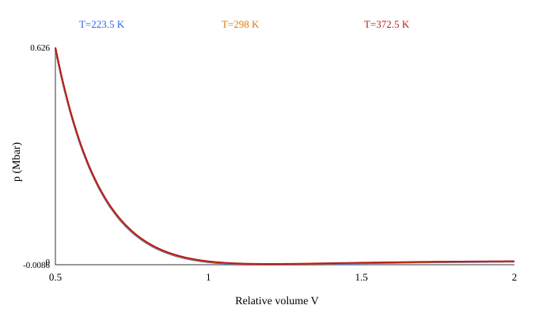
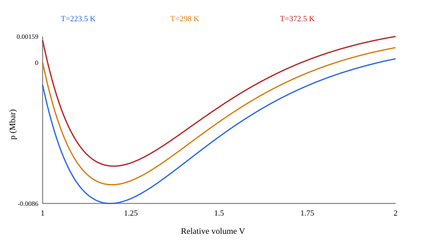

# tnt: Lee–Tarver audit

## Identification

- Calibration: Two-term calibration from Lee and Tarver (1980, doi:10.1063/1.862940); G2 card slot carries its sole growth term. DRDC reports Bp=0.032306 Mbar: https://publications.gc.ca/collections/collection_2019/rddc-drdc/D68-6-401-2014-eng.pdf
- Initial density: 1.61 g/cm³ (calibration density); temperature: 298 K.
- Source: [FOI-R--0151--SE, Table 1 (cast TNT); DRDC TM 2013-4015 for Bp precision](https://www.foi.se/rest-api/report/FOI-R--0151--SE). Raw values: literature; stored units: cm–g–µs (Mbar, µs).
- Status: **verified_with_corrections**. Published ω and Cv determine G and R3.

## Density consistency

| EOS calibration ρ0 | Kinetic calibration ρ0 | *MAT RO | Library output |
|---:|---:|---:|---|
| 1.61 | 1.61 | 1.61 | stored density is enforced when a MAT card exists |

Changing RO requires a separately identified calibration; the material loader rejects silent density edits to these source-backed cards.

## Product EOS

p_p = A exp(−XP1 V_p) + B exp(−XP2 V_p) + G T_p/V_p, where G=ω_p CVP.

| Model | LS-DYNA | Raw (Mbar, Mbar/K) | mm–mg–µs (GPa, GPa/K) |
|---|---|---:|---:|
| A | A | 3.712 | 371.2 |
| B | B | 0.032306 | 3.2306 |
| R1 | XP1 | 4.15 | 4.15 |
| R2 | XP2 | 0.95 | 0.95 |
| ω | G/CVP | 0.3 | 0.3 |
| Cv | CVP | 1e-05 | 0.001 |
| ωCv | G | 3e-06 | 0.0003 |

## Unreacted EOS

p_e = R1 exp(−R5 V_e) + R2 exp(−R6 V_e) + R3 T_e/V_e, where R3=ω_e CVR for a sourced ω_e.

| Model | LS-DYNA | Raw (Mbar, Mbar/K) | mm–mg–µs (GPa, GPa/K) |
|---|---|---:|---:|
| A | R1 | 17.98 | 1798 |
| B | R2 | -0.931 | -93.1 |
| R1 | R5 | 6.2 | 6.2 |
| R2 | R6 | 3.1 | 3.1 |
| ω | R3/CVR | 0.8926 | 0.8926 |
| Cv | CVR | 2.05e-05 | 0.00205 |
| ωCv | R3 | 1.82983e-05 | 0.00182983 |

At V=1, T=T0: source p0=1.2488122e-06 Mbar; **card p0=1.1594122e-06 Mbar = 0.00011594122 GPa**.
Expected initial pressure: 0 Mbar (nominal ambient state).
Source G/CVP=0.3, R3/CVR=0.8926; card G/CVP=0.3, R3/CVR=0.89258537.
Initial pressure residual is below 1 MPa.
Automated flags: none. A ratio outside [0, 2] requires manual review; a residual over 1 MPa is flagged, without imposing p0=0 on every calibration.
The source values in the tables determine the card coefficients; the displayed card is [here](tnt.k).

## Ignition and Growth kinetics

The LS-DYNA equation is dF/dt = I(1−F)^b(1/V_e−1−a)^x + G1(1−F)^c F^d p^y + G2(1−F)^e F^g p^z, with each term restricted by its listed F limits. Pressure p is in the active unit system. TNT uses only its ignition and one growth term, placed in the GROW2 card slot. The FOI paper calls its ignition depletion exponent *a* (FRER here), critical compression *µc* (CCRIT), and its growth exponents *b*, *c* (ES2, AR2).

Field definitions follow the [LS-DYNA R13 EOS 7 manual](https://ftp.lstc.com/anonymous/outgoing/jday/manuals/LS-DYNA_Manual_Volume_II_R13.pdf).

| Model | LS-DYNA | Raw | mm–mg–µs |
|---|---|---:|---:|
| I | FREQ | 50 | 50 |
| µc | CCRIT | 0 | 0 |
| a | FRER | 0.222 | 0.222 |
| x | EETAL | 4 | 4 |
| F_ig,max | FMXIG | 1 | 1 |
| G1 | GROW1 | 0 | 0 |
| c | ES1 | 0 | 0 |
| d | AR1 | 0 | 0 |
| y | EM | 0 | 0 |
| F_g1,max | FMXGR | 1 | 1 |
| G1 (FOI) | GROW2 | 40 | 0.15924287 |
| b (FOI) | ES2 | 0.222 | 0.222 |
| c (FOI) | AR2 | 0.667 | 0.667 |
| y (FOI) | EN | 1.2 | 1.2 |
| F_g2,min | FMNGR | 0 | 0 |

FREQ has unit µs⁻¹. GROW1 and GROW2 have units Mbar⁻ʸ µs⁻¹ and Mbar⁻ᶻ µs⁻¹. Conversion to GPa pressure units divides them by 100^y and 100^z. This keeps each Gp^n unchanged. The same µs time unit needs no rate multiplier.

## Dimensions and ENQ

The working base units are mm, mg, µs. Derived units: density mg/mm³ = 1000 kg/m³; speed mm/µs = 1000 m/s; acceleration mm/µs² = 10⁹ m/s²; force mg·mm/µs² = 10³ N; pressure mg/(mm·µs²) = 1 GPa; energy mg·mm²/µs² = 1 J; specific energy mm²/µs² = 10⁶ J/kg. Card CVP, CVR, G and R3 are heat capacity or thermal pressure coefficients **per reference volume**, in GPa/K; mass-specific heat instead has dimension J/(kg·K). ENQ maps to published E0 per reference volume, so 0.07 Mbar becomes 7 GPa; it is not treated as mass-specific energy. This mapping is documented in an [LS-DYNA Users Conference paper](https://lsdyna.ansys.com/wp-content/uploads/attachments/blast-impact13-d.pdf). I has dimension T⁻¹; Gi has dimension P⁻ⁿT⁻¹.

## Applicability and EOS scan

Scan: 0.5≤V≤2.0, T=0.75T0, T0, 1.25T0. At T0, pressure ranges from -0.0074583584 to 0.62328758 Mbar. Negative p at T0: starts by V≈1.01. First nonpositive adiabatic bulk modulus: V≈1.25, T=223.5 K; this also flags potential c²≤0 because c²=V K_S/ρ0. K_S=V(A_e R1e exp(−R1e V)+B_e R2e exp(−R2e V))+ω_e(1+ω_e)Cv,e T/V. Nonfinite values: False. The scan diagnoses extrapolation only; it does not establish a valid tensile range. Published tensile limits, pressure cutoffs, phase-mixing rules and AUTODYN-to-LS-DYNA equivalence are **not established** for this set.

- Published pressure and compression calibration ranges: not established from the cited table.
- Tensile calibration range, maximum unreacted V, pressure cutoff and temperature bounds: not established.
- AUTODYN and LS-DYNA mixture or extrapolation equivalence: not established; no such rule is silently transferred.

## Changes from the legacy card

| Field | Old | New | Reason and source |
|---|---:|---:|---|
| MAT RO | 1.63 | 1.61 | cast TNT calibration density; [FOI-R--0151--SE, Table 1 (cast TNT); DRDC TM 2013-4015 for Bp precision](https://www.foi.se/rest-api/report/FOI-R--0151--SE) |
| TMP0 | 288 | 298 | source temperature; [FOI-R--0151--SE, Table 1 (cast TNT); DRDC TM 2013-4015 for Bp precision](https://www.foi.se/rest-api/report/FOI-R--0151--SE) |
| CVR | 2.172e-5 | 2.05e-5 | published heat capacity; [FOI-R--0151--SE, Table 1 (cast TNT); DRDC TM 2013-4015 for Bp precision](https://www.foi.se/rest-api/report/FOI-R--0151--SE) |
| R3 | 1.22653e-5 | 0.8926 × 2.05e-5 | published omega and heat capacity; [FOI-R--0151--SE, Table 1 (cast TNT); DRDC TM 2013-4015 for Bp precision](https://www.foi.se/rest-api/report/FOI-R--0151--SE) |

## Confirmed / corrected / disputed / unconfirmed

- Confirmed: published EOS, rates, T0 and density.
- Corrected: MAT RO, TMP0, CVR, R3.
- Disputed: no conflicting source for the same identified calibration has been established.
- Unconfirmed: tensile and extrapolation limits.
