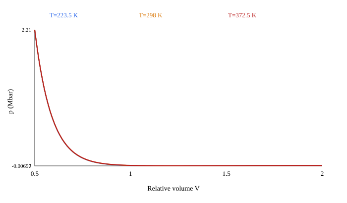
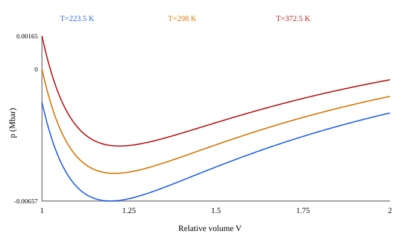

# ultrafine tatb: Lee–Tarver audit

## Identification

- Calibration: Published source gives omega_e=0.8938; R3 is calculated from omega_e Cv.
- Initial density: 1.8 g/cm³ (calibration density); temperature: 298 K.
- Source: [LLNL, Ignition and Growth parameters for LX-17 and ultrafine TATB, Table 1B](https://www.osti.gov/servlets/purl/15016041). Raw values: literature; stored units: cm–g–µs (Mbar, µs).
- Status: **verified_with_corrections**. Published ω and Cv determine G and R3.

## Density consistency

| EOS calibration ρ0 | Kinetic calibration ρ0 | *MAT RO | Library output |
|---:|---:|---:|---|
| 1.8 | 1.8 | 1.8 | stored density is enforced when a MAT card exists |

Changing RO requires a separately identified calibration; the material loader rejects silent density edits to these source-backed cards.

## Product EOS

p_p = A exp(−XP1 V_p) + B exp(−XP2 V_p) + G T_p/V_p, where G=ω_p CVP.

| Model | LS-DYNA | Raw (Mbar, Mbar/K) | mm–mg–µs (GPa, GPa/K) |
|---|---|---:|---:|
| A | A | 12.05026 | 1205.026 |
| B | B | 0.602513 | 60.2513 |
| R1 | XP1 | 6.2 | 6.2 |
| R2 | XP2 | 2.2 | 2.2 |
| ω | G/CVP | 0.5 | 0.5 |
| Cv | CVP | 1e-05 | 0.001 |
| ωCv | G | 5e-06 | 0.0005 |

## Unreacted EOS

p_e = R1 exp(−R5 V_e) + R2 exp(−R6 V_e) + R3 T_e/V_e, where R3=ω_e CVR for a sourced ω_e.

| Model | LS-DYNA | Raw (Mbar, Mbar/K) | mm–mg–µs (GPa, GPa/K) |
|---|---|---:|---:|
| A | R1 | 632.07 | 63207 |
| B | R2 | -0.04472 | -4.472 |
| R1 | R5 | 11.3 | 11.3 |
| R2 | R6 | 1.13 | 1.13 |
| ω | R3/CVR | 0.8938 | 0.8938 |
| Cv | CVR | 2.487e-05 | 0.002487 |
| ωCv | R3 | 2.2228806e-05 | 0.0022228806 |

At V=1, T=T0: source p0=-1.3088011e-06 Mbar; **card p0=-1.2509891e-06 Mbar = -0.00012509891 GPa**.
Expected initial pressure: 0 Mbar (nominal ambient state).
Source G/CVP=0.5, R3/CVR=0.8938; card G/CVP=0.5, R3/CVR=0.8938078.
Initial pressure residual is below 1 MPa.
Automated flags: none. A ratio outside [0, 2] requires manual review; a residual over 1 MPa is flagged, without imposing p0=0 on every calibration.
The source values in the tables determine the card coefficients; the displayed card is [here](ultrafine-tatb.k).

## Ignition and Growth kinetics

The LS-DYNA equation is dF/dt = I(1−F)^b(1/V_e−1−a)^x + G1(1−F)^c F^d p^y + G2(1−F)^e F^g p^z, with each term restricted by its listed F limits. Pressure p is in the active unit system.

Field definitions follow the [LS-DYNA R13 EOS 7 manual](https://ftp.lstc.com/anonymous/outgoing/jday/manuals/LS-DYNA_Manual_Volume_II_R13.pdf).

| Model | LS-DYNA | Raw | mm–mg–µs |
|---|---|---:|---:|
| I | FREQ | 4000000 | 4000000 |
| a | CCRIT | 0.22 | 0.22 |
| b | FRER | 0.667 | 0.667 |
| x | EETAL | 7 | 7 |
| F_ig,max | FMXIG | 0.071 | 0.071 |
| G1 | GROW1 | 2200 | 0.22 |
| c | ES1 | 0.667 | 0.667 |
| d | AR1 | 1 | 1 |
| y | EM | 2 | 2 |
| F_g1,max | FMXGR | 1 | 1 |
| G2 | GROW2 | 60 | 0.6 |
| e | ES2 | 0.667 | 0.667 |
| g | AR2 | 0.667 | 0.667 |
| z | EN | 1 | 1 |
| F_g2,min | FMNGR | 0.8 | 0.8 |

FREQ has unit µs⁻¹. GROW1 and GROW2 have units Mbar⁻ʸ µs⁻¹ and Mbar⁻ᶻ µs⁻¹. Conversion to GPa pressure units divides them by 100^y and 100^z. This keeps each Gp^n unchanged. The same µs time unit needs no rate multiplier.

## Dimensions and ENQ

The working base units are mm, mg, µs. Derived units: density mg/mm³ = 1000 kg/m³; speed mm/µs = 1000 m/s; acceleration mm/µs² = 10⁹ m/s²; force mg·mm/µs² = 10³ N; pressure mg/(mm·µs²) = 1 GPa; energy mg·mm²/µs² = 1 J; specific energy mm²/µs² = 10⁶ J/kg. Card CVP, CVR, G and R3 are heat capacity or thermal pressure coefficients **per reference volume**, in GPa/K; mass-specific heat instead has dimension J/(kg·K). ENQ maps to published E0 per reference volume, so 0.069 Mbar becomes 6.9 GPa; it is not treated as mass-specific energy. This mapping is documented in an [LS-DYNA Users Conference paper](https://lsdyna.ansys.com/wp-content/uploads/attachments/blast-impact13-d.pdf). I has dimension T⁻¹; Gi has dimension P⁻ⁿT⁻¹.

## Applicability and EOS scan

Scan: 0.5≤V≤2.0, T=0.75T0, T0, 1.25T0. At T0, pressure ranges from -0.005190973 to 2.2111481 Mbar. Negative p at T0: starts by V≈1.00. First nonpositive adiabatic bulk modulus: V≈1.25, T=223.5 K; this also flags potential c²≤0 because c²=V K_S/ρ0. K_S=V(A_e R1e exp(−R1e V)+B_e R2e exp(−R2e V))+ω_e(1+ω_e)Cv,e T/V. Nonfinite values: False. The scan diagnoses extrapolation only; it does not establish a valid tensile range. Published tensile limits, pressure cutoffs, phase-mixing rules and AUTODYN-to-LS-DYNA equivalence are **not established** for this set.

- Published pressure and compression calibration ranges: not established from the cited table.
- Tensile calibration range, maximum unreacted V, pressure cutoff and temperature bounds: not established.
- AUTODYN and LS-DYNA mixture or extrapolation equivalence: not established; no such rule is silently transferred.

## Changes from the legacy card

| Field | Old | New | Reason and source |
|---|---:|---:|---|
| R3 | 2.22e-5 | 0.8938 × 2.487e-5 | published omega and heat capacity; [LLNL, Ignition and Growth parameters for LX-17 and ultrafine TATB, Table 1B](https://www.osti.gov/servlets/purl/15016041) |
| AR1 | 0.667 | 1.0 | published exponent d; [LLNL, Ignition and Growth parameters for LX-17 and ultrafine TATB, Table 1B](https://www.osti.gov/servlets/purl/15016041) |
| ES1 | 1.0 | 0.667 | published exponent c; [LLNL, Ignition and Growth parameters for LX-17 and ultrafine TATB, Table 1B](https://www.osti.gov/servlets/purl/15016041) |

## Confirmed / corrected / disputed / unconfirmed

- Confirmed: published EOS, rates, T0 and density.
- Corrected: R3, AR1, ES1.
- Disputed: no conflicting source for the same identified calibration has been established.
- Unconfirmed: tensile and extrapolation limits.
